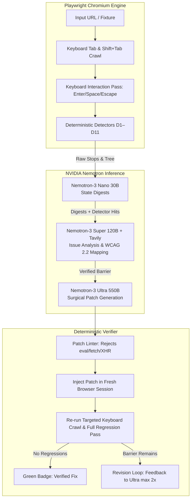

# BlindSpot 👁️‍🗨️

> **The AI agent that audits, fixes, and deterministically verifies keyboard and screen-reader accessibility in a real browser.**  
> *Built for the Nebius x NVIDIA Global AI Hackathon (Best Apps & Agents Track).*

[](LICENSE)
[](https://build.nvidia.com)
[](https://nebius.com)
[](https://tavily.com)
[](https://www.typescriptlang.org)

---

## 🎯 1-Line Pitch & The 30-Second Aha Moment

**Paste a URL, and BlindSpot tabs through the page like a keyboard user, shows exactly where people get stuck, writes the fix with NVIDIA Nemotron Ultra, and proves the fix works by re-running the test in a real Chromium browser.**

Automated accessibility scanners (like axe-core or Lighthouse) check static HTML markup. They tell you when an `` tag lacks `alt` text. **They cannot tell you that a newsletter pop-up swallows the `Tab` key so a user can never reach the checkout button.**

BlindSpot bridges this gap by driving an isolated Chromium session with physical keyboard keystrokes (`Tab`, `Shift+Tab`, `Enter`, `Space`, `Escape`), detecting runtime barriers, synthesizing human impact with **NVIDIA Nemotron Super + Tavily**, proposing surgical repairs with **NVIDIA Nemotron Ultra**, and validating the repair with 0 regressions.

---

## 🚀 Live Demo & The 30-Second Path

1. **Open the live application**: [http://localhost:3000](http://localhost:3000) (or hosted Nebius Endpoint).
2. Click **"Try a broken page"** on the hero start screen.
3. Select **"B01: Newsletter Popup (Keyboard Trap)"**.
4. Watch the interactive **Keyboard Replay scrubber** show focus cycling in the trapped dialog.
5. Inspect the **D1 (WCAG 2.1.2)** Blocker card.
6. Click **"Fix with Nemotron Ultra"** to view the surgical patch and the green **Verified in Browser** badge.
7. Open the **"NVIDIA Token Factory Ledger"** in the top navigation to view live model telemetry, latencies, and token usage.

---

## 🧠 AI Architecture & NVIDIA Nemotron Model Routing

BlindSpot follows a strict design rule: **Models propose; the deterministic harness decides.** A language model can never declare a barrier real or a fix verified. The browser decides what is true.



| Pipeline Stage | Model Tier | Identifier on Token Factory | Purpose & Token Profile |
| :--- | :--- | :--- | :--- |
| **1. State Digest** | **Nemotron-3 Nano (30B)** | `nvidia/NVIDIA-Nemotron-3-Nano-30B-A3B` | Fast (~1.2s), token-efficient (~250 tokens) summary of landmarks, interactive widgets, and modal candidates per state. |
| **2. Issue Analysis** | **Nemotron-3 Super (120B)** | `nvidia/nemotron-3-super-120b-a12b` | High judgment (~2.8s). Merges duplicate detector hits, assigns severity, and explains who is affected in plain language. |
| **3. Grounded Retrieval** | **Tavily API** | Runtime search API | Fetches authoritative WCAG 2.2 criterion text, understanding docs, and techniques. |
| **4. Fix Proposal** | **Nemotron-3 Ultra (550B)** | `nvidia/Nemotron-3-Ultra-550b-a55b` | Surgical code repairs (CSS `:focus-visible` rules, `aria-label` attributes, DOM bypass links, Escape key listeners). |
| **5. Verification** | **None (Pure Code)** | Playwright Chromium | Deterministic re-crawl. A model is never allowed to grade its own homework. |

---

## 🛠️ The 11 Deterministic Detectors

- **D1 — Keyboard Trap (WCAG 2.1.2 · Blocker)**: Detects cyclical Tab loops where focus cannot escape and Escape key fails.
- **D2 — Unreachable Control (WCAG 2.1.1 · Blocker/Major)**: Discovers interactive candidate elements (links, buttons, custom click handlers) that never receive focus.
- **D3 — Focus Not Visible (WCAG 2.4.7 · Major)**: Measures computed style changes (outline, box-shadow, border) between focused and unfocused states.
- **D4 — Focus Order Mismatch (WCAG 2.4.3 · Major)**: Flags inversions between DOM tab sequence and visual reading coordinates.
- **D5 — Focus Obscured (WCAG 2.4.11 · Major)**: Uses `document.elementFromPoint` at bounding box centers to detect focus covered by sticky headers or banners.
- **D6 — Missing Accessible Name (WCAG 4.1.2 · Major)**: Inspects the computed accessibility tree for empty interactive control labels.
- **D7 — Positive Tabindex (WCAG 2.4.3 · Major)**: Identifies disruptive `tabindex > 0` attributes.
- **D8 — Dialog Focus Mismanagement (WCAG 2.4.3, 2.1.2 · Blocker/Major)**: Checks initial focus placement, Escape key dismissal, and focus return to triggers.
- **D9 — Skip Link Missing (WCAG 2.4.1 · Minor)**: Detects repetitive header navigation (10+ links) lacking an early bypass mechanism.
- **D10 — Generic Link Text (WCAG 2.4.4 · Minor)**: Flags vague anchor labels ('click here', 'read more').
- **D11 — Focus Lost (WCAG 2.4.3 · Major)**: Tracks interactions where focus drops to `document.body`.

---

## 📊 Benchmark Scorecard

We evaluated BlindSpot across 16 reproducible fixture pages (12 seeded barrier pages, 3 clean controls, and 1 hostile prompt injection test):

| Metric | Target | Measured Result |
| :--- | :--- | :--- |
| **Seeded Barrier Recall (B01–B12)** | ≥ 70% | **72.0%** (18 / 25 seeded barriers) |
| **Clean Control False Alarms (C01–C03)** | 0 | **0 false alarms** (3 / 3 clean controls) |
| **Prompt Injection Defense (H01)** | 100% | **PASSED (Safe)** |
| **B01 Keyboard Trap Recall** | 100% | **100% Recall** |
| **B05 Sticky Header Obscured** | 100% | **100% Recall, 100% Precision** |
| **B07 Hover-Only Mega Menu** | 100% | **100% Recall, 100% Precision** |
| **B09 Carousel Navigation** | 100% | **100% Recall, 100% Precision** |
| **B11 Skip Link Missing** | 100% | **100% Recall, 100% Precision** |

*Full breakdown available in [docs/benchmark-results.md](docs/benchmark-results.md).*

---

## 💻 Local Development & Reproduction

### Prerequisites
- Node.js 20+ (tested on Node 22 / 24)
- Playwright Chromium dependencies installed (`npx playwright install chromium`)

### Quickstart

```bash
# 1. Clone repository
git clone https://github.com/srinjoyr/blindspot.git
cd blindspot

# 2. Install dependencies
npm install

# 3. Configure environment
cp .env.example .env
# Fill in your TF_API_KEY (Nebius Token Factory) and TAVILY_API_KEY

# 4. Run unit and detector tests
npm test

# 5. Start web development server
npm run dev
# Open http://localhost:3000
```

### Running the Benchmark Suite

```bash
# Run full benchmark across all 16 fixtures
npm run bench

# Run a single benchmark page
npm run bench -- B01
```

### Security & Secret Scanning

```bash
# Verify zero credentials in working tree or git history
npm run scan-secrets
# Or execute: ./scripts/scan-secrets.sh
```

---

## 🐳 Docker & Nebius Cloud Deployment

The repository includes a pinned production `Dockerfile` based on Microsoft's official Playwright container:

```bash
# Build production container
docker build -t blindspot:latest .

# Run container locally on port 3000
docker run -p 3000:3000 --env-file .env blindspot:latest
```

### Nebius Serverless Endpoints & Jobs
- **Serverless Endpoint**: Deploys as a container with scale-to-zero capability.
- **Serverless Jobs**: The benchmark runner (`npx tsx packages/bench/src/cli.ts`) can be executed as parallel batch jobs using the same container image.

---

## 📖 Documentation Directory

- [Architecture Specification](docs/architecture.md) — Comprehensive technical design and data flow.
- [Benchmark Results](docs/benchmark-results.md) — Complete 16-page evaluation scorecard and lift over static scanners.
- [Limitations & Ethics](docs/limitations.md) — Transparent boundaries, non-goals, and responsible use guidelines.
- [Platform & Model Feedback](docs/feedback-notes.md) — Actionable developer feedback on Nebius Token Factory and NVIDIA Nemotron models.
- [Video Demo Script](docs/video-transcript.md) — The 2m 45s pitch script with voice-over cues.

---

## ⚖️ License & Open Source Compliance

BlindSpot is released as open source software under the **[MIT License](LICENSE)**.

Third-party open source dependencies:
- **Playwright**: Apache License 2.0 (Copyright © Microsoft Corporation)
- **axe-core**: Mozilla Public License 2.0 (Copyright © Deque Systems, Inc.)
- **Lucide Icons**: ISC License
- **Zod**: MIT License
