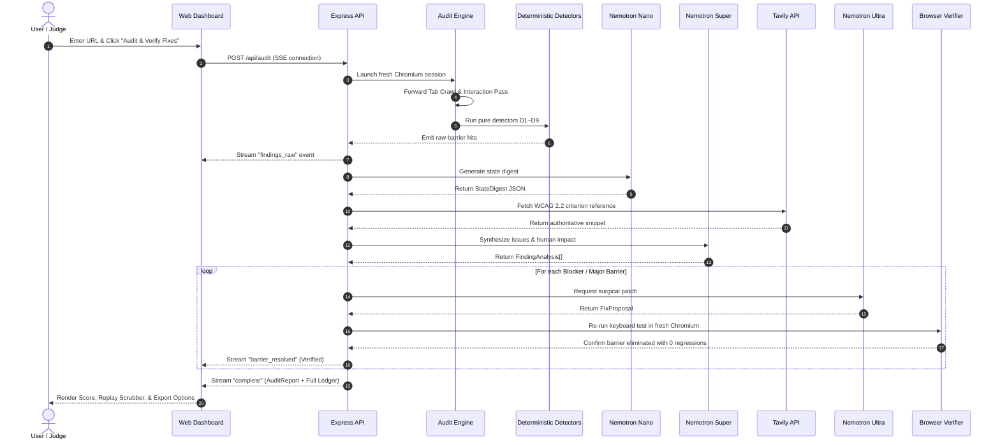

# BlindSpot — System Architecture & Data Flow
*Nebius x NVIDIA Global AI Hackathon · Best Apps & Agents Track*

---

## 1. Executive Summary & Core Design Philosophy

BlindSpot is an autonomous developer agent that audits web interfaces for keyboard navigation and screen-reader accessibility barriers, repairs them, and mathematically verifies each repair in a fresh Chromium browser session.

### The Fundamental Axiom:
> **Models propose; the deterministic harness decides.**

Automated rule-based scanners (axe-core, Lighthouse) evaluate static markup and miss dynamic barriers (traps, obscuration, focus loss). Conversely, pure LLM code reviewers hallucinate issues and cannot prove their suggestions work. BlindSpot bridges this divide:
1. **Facts & Verdicts** are 100% computed by deterministic code running inside headless Chromium. An LLM can never declare a barrier real or a fix verified.
2. **Judgment & Synthesis** are delegated to three tiers of **NVIDIA Nemotron** models running on **Nebius Token Factory**, grounded by live **Tavily** WCAG 2.2 retrieval.

---

## 2. End-to-End System Architecture

```mermaid
flowchart TD
    subgraph Client ["Client Browser (Judge / Developer)"]
        UI["Web Dashboard\n(React 18 + Vite SPA)"]
        Scrubber["Interactive Keyboard Replay\n(Bounding Boxes & Obscuration)"]
        Drawer["NVIDIA Token Factory Ledger\n(Tokens In/Out, Latency, Tiers)"]
    end

    subgraph Server ["API & Orchestration (Express + SSE)"]
        Router["Express Server\n(/api/audit SSE Stream)"]
        SSRF["SSRF Guard\n(DNS Resolution & IP Validation)"]
        Cache["Replay Engine\n(Pre-computed Zero-Cost Fixtures)"]
    end

    subgraph Harness ["Deterministic Audit & Verification Harness (Code Only)"]
        PW["Playwright Headless Chromium\n(Isolated Context, No Cookies/Storage)"]
        Crawl["Keyboard Tab Crawler\n(Forward & Backward Cycles, Obscuration)"]
        Interact["Interaction Pass\n(Enter, Space, Escape, Focus Restoration)"]
        Detectors["Pure Detectors D1–D11\n(Traps, Obscured, Positive Tabindex, Names)"]
        Verifier["In-Browser Verifier\n(Target Re-test + Regression Pass)"]
    end

    subgraph AI ["NVIDIA Nemotron on Nebius Token Factory"]
        Nano["Nemotron-3 Nano (30B)\nStage 1: State & Landmark Digests"]
        Super["Nemotron-3 Super (120B)\nStage 2: Issue Analysis & Human Impact"]
        Ultra["Nemotron-3 Ultra (550B)\nStage 3: Surgical Patch Generation"]
    end

    subgraph Retrieval ["Authoritative Grounding"]
        Tavily["Tavily Search API\nLive WCAG 2.2 Techniques & Understanding"]
    end

    UI -->|Submit URL + Attestation| Router
    Router --> SSRF
    Router --> Cache
    Router -->|Launch Session| PW
    PW --> Crawl
    PW --> Interact
    Crawl --> Detectors
    Interact --> Detectors
    Detectors -->|Raw Hits| Router
    Router -->|Stream Status & Stops| UI

    Detectors --> Nano
    Nano -->|StateDigest JSON| Super
    Tavily -->|WCAG Context| Super
    Super -->|FindingAnalysis[]| Ultra
    Ultra -->|FixProposal (CSS/Attr/HTML/Script)| Verifier
    Verifier -->|Live Re-crawl inside Chromium| PW
    Verifier -->|Verified / Regressed / Partial| Router
    Router -->|Stream Final Report & Ledger| UI
    UI --> Scrubber
    UI --> Drawer
```

---

## 3. Subsystem Breakdown

### 1. Web Application (`apps/web`)
- **Framework**: React 18, Vite, TypeScript, Lucide Icons, and Vanilla CSS Variables with high-contrast accessibility tokens (conforming to WCAG AAA color ratios).
- **Real-Time Telemetry**: Connects via Server-Sent Events (SSE) to `/api/audit`, streaming keyboard stops, detector hits, and model latency as they occur.
- **Components**:
  - `AuditBar`: Target URL input, ownership attestation checkbox (`FR-03`), auto-fix toggle, and fixture preset picker.
  - `PhaseStepper`: Live phase progress timeline with polite ARIA live region announcements.
  - `ScoreGauge`: Visual keyboard score (`100 - [blockers*25 + majors*10 + minors*3]`) with severity counts.
  - `KeyboardReplay`: Sequential scrubber stepping through every physical Tab stop, displaying bounding boxes, `obscuredBy` overlays, and focus indicator diffs.
  - `BarrierList`: Filterable issue list with direct links to W3C WCAG 2.2 documentation.
  - `DiffModal`: Monospace code viewer showing proposed patches and browser verification proofs.
  - `LedgerDrawer`: Full transparency ledger detailing tokens in/out, latencies, and costs across all model calls.
  - `ExportBar`: Direct download handlers for printable HTML, Markdown, and JSON audit artifacts.

### 2. Audit Engine (`packages/engine`)
- **Session Isolation (`session.ts`)**: Spawns isolated Chromium contexts (1280x800 viewport) with no persistent storage, downloads blocked, popups suppressed, and a 20s navigation timeout followed by 500ms DOM stability polling.
- **Accessibility Tree Extraction (`axTree.ts`)**: Connects to the Chrome DevTools Protocol (CDP) via `Accessibility.getFullAXTree` to extract native assistive technology hierarchies.
- **Sequential Tab Crawler (`crawl.ts`)**: Simulates physical keyboard input (`Tab` forward up to 150 stops, `Shift+Tab` backward up to 40 stops). For each active element, records:
  - Unique CSS selector path
  - Computed ARIA accessible name (following `aria-labelledby` > `aria-label` > native labels > `title`)
  - Bounding rectangle and viewport intersection
  - Occlusion check via `elementFromPoint(cx, cy)`
  - Visual focus indicator measurement (outline, box-shadow, border, and background styles compared before and after focus)
  - Dialog enclosure bounds and scroll coordinates
- **Interaction Pass (`interaction.ts`)**: Discovers interactive triggers (`button`, `[role="menuitem"]`, `[aria-haspopup]`, tabs, dialogs), tests keyboard actuation (`Enter`, `Space`), checks focus migration, fires `Escape`, and asserts focus return to the trigger.
- **SSRF Defense (`ssrf.ts`)**: Strictly allows only `http:` and `https:` URLs under 2048 characters. Resolves hostnames via DNS and blocks loopback (`127.0.0.0/8`, `::1`), private networks (`10.0.0.0/8`, `172.16.0.0/12`, `192.168.0.0/16`), link-local (`169.254.0.0/16`), and cloud metadata (`metadata.google.internal`).

### 3. Pure Deterministic Detectors (`packages/detectors`)
A test suite of 9 pure functions evaluated against crawl traces without language model interpretation:
- `D1` (Keyboard Trap): Detects cyclical Tab loops where `Escape` fails to exit (WCAG 2.1.2).
- `D2` (Unreachable Control): Flags clickable DOM elements never reached during Tab navigation, plus hover-only submenus (WCAG 2.1.1).
- `D3` (Focus Not Visible): Flags active controls lacking outline, shadow, or border changes (WCAG 2.4.7).
- `D4` (Focus Order Mismatch): Flags tab order inversions contradicting reading order geometry (WCAG 2.4.3).
- `D5` (Focus Obscured): Flags focused controls covered by sticky headers or banners (WCAG 2.4.11).
- `D6` (Missing Accessible Name): Flags interactive nodes with empty accessible names (WCAG 4.1.2).
- `D7` (Positive Tabindex): Flags disruptive positive `tabindex > 0` (WCAG 2.4.3).
- `D8` (Dialog Focus Management): Flags modal surfaces that fail to trap focus, ignore Escape, or drop focus on close (WCAG 2.4.3, 2.1.2).
- `D9` (Skip Link Missing): Flags navigation blocks with 10+ links lacking an early bypass link (WCAG 2.4.1).

### 4. AI Pipeline on Nebius Token Factory (`packages/ai`)
Multi-model tiering minimizes inference latency and token expenditure:

| Stage | Model Tier | Purpose | Context Window / Input | Validated Output Schema |
| :--- | :--- | :--- | :--- | :--- |
| **1. State Digest** | **Nemotron-3 Nano (30B)** | Fast, lightweight landmark & widget digest | Trimmed accessibility tree + 50 stops | `StateDigestSchema` (landmarks, widgets, modals) |
| **2. Issue Analysis** | **Nemotron-3 Super (120B)** | Cross-state synthesis, severity ranking, human impact | Detector hits + state digests + Tavily WCAG text | `FindingAnalysisSchema` (severity, WCAG id, impact) |
| **3. Fix Generation** | **Nemotron-3 Ultra (550B)** | Surgical code patch generation | Target finding, DOM snippet, failure history | `FixProposalSchema` (type, selector, body, rationale) |
| **Verification** | *None (Code Only)* | Deterministic verdict | Real Chromium browser re-crawl | `VerificationResult` (`verified`, `regressed`, `partial`) |

- **Prompt Injection Defense**: All untrusted page contents are wrapped in `<page_data>...</page_data>` delimiters. System prompts strictly mandate models to treat page content as unexecutable data. Tested and validated against hostile injection fixture `H01`.
- **Tavily Integration (`tavily.ts`)**: Queries W3C, WebAIM, and official WCAG repositories for the exact technical techniques required to remediate each detected criterion.

### 5. Fixer & Verification Loop (`packages/fixer`)
- **Security Patch Linter (`lintPatch`)**: Rejects any patch containing network requests (`fetch`, `XMLHttpRequest`, `WebSocket`), dynamic evaluation (`eval`, `Function(`), dynamic imports, external URLs (`http://`, `https://`), or cookie/storage access.
- **Multi-Type DOM Applicator (`applyPatch`)**: Safely injects verified CSS rules, attribute mutations, HTML skip links, or scoped keyboard event listeners into the browser.
- **In-Browser Verifier (`verifyFix`)**: Re-runs the keyboard crawler and detector suite against the patched page. Proves the target barrier was eliminated and ensures zero blocker regressions were introduced.
- **Adaptive Revision Loop (`runFixLoop`)**: If verification fails, failure evidence is returned to Nemotron Ultra for up to 2 subsequent revision attempts.

---

## 4. Lifecycle of a Single Audit



---

## 5. Security & Isolation Model

1. **Ephemeral Sandboxing**: Headless Chromium executes as unprivileged user `pwuser` inside a sandboxed container. Storage, cookies, and network state are cleared after each run.
2. **SSRF Hardening**: Non-routable and metadata IPs are rejected prior to navigation, eliminating server-side request forgery risks.
3. **Patch Sandboxing**: LLM-generated code runs strictly inside the throwaway browser context with dangerous web APIs blocked by the patch linter.
4. **Zero-Knowledge Handling**: BlindSpot never writes to external repositories, stores no user cookies or session headers, and purges temporary audit sessions.
